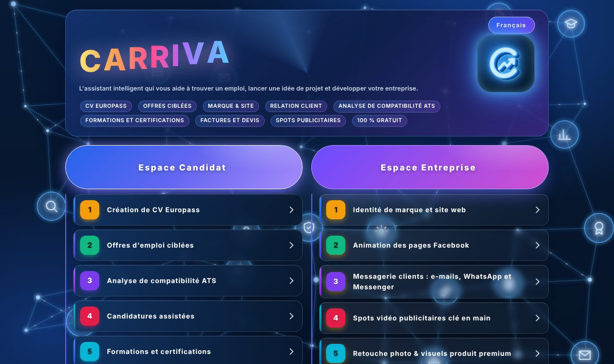
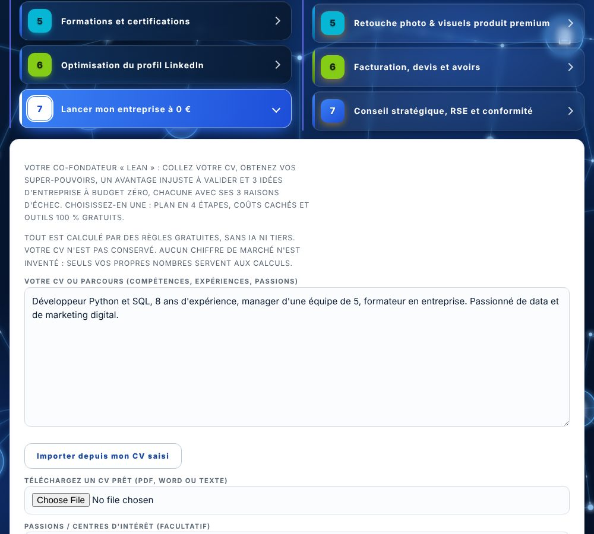
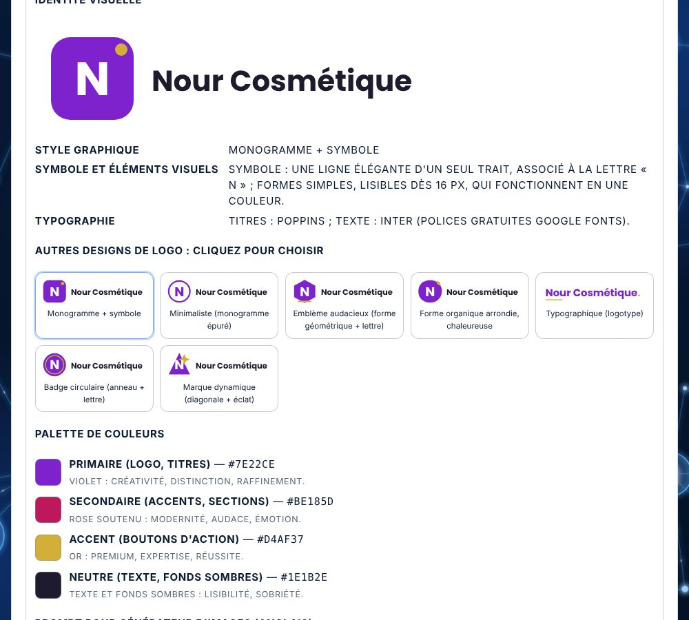
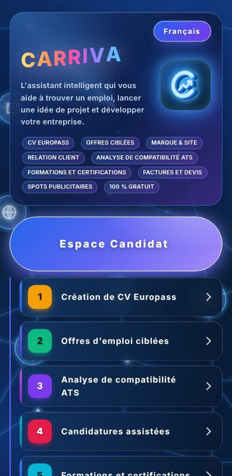

<div align="center">

## 👋 Hello and welcome!

**CARRIVA** is a free app for two kinds of people: those **looking for a job** (CV, job offers, applications, training) and those **running a business or starting a project** (brand, website, customers, advertising, invoices).  
It is available in 6 languages and installs like an app on your phone or computer.



<sub>Home page: the Job Seeker space on the left, the Business space on the right.</sub>

# CARRIVA

### L'assistant intelligent qui vous aide à trouver un emploi, lancer une idée de projet et développer votre entreprise.

**Gratuit par défaut · Sans carte bancaire · 6 langues · Installable comme une application**

[](https://github.com/Nawresba-prog/CARRIVA/actions/workflows/ci.yml)


</div>

---

## Pourquoi CARRIVA ?

Une seule application pour **deux publics** :

- vous **cherchez un emploi** : faites votre CV, trouvez des offres, vérifiez qu'un logiciel de recrutement lira bien votre CV, postulez et formez-vous ;
- vous **avez une entreprise ou une idée** : créez votre marque et votre site, répondez à vos clients, créez vos spots publicitaires, vos factures et votre stratégie.

Tout fonctionne **sans abonnement et sans IA obligatoire**. Les agents travaillent avec des règles transparentes ; une clé d'IA est **facultative** pour aller plus loin.

## Ce que vous pouvez faire

### Espace Candidat
| # | Outil | À quoi ça sert |
|---|---|---|
| 1 | **CV Europass** | Créer un CV propre (modèles, PDF), saisie vocale, import d'un CV existant (PDF, Word, texte) |
| 2 | **Offres ciblées** | Offres adaptées à votre profil, alertes |
| 3 | **Compatibilité ATS** | Taux de correspondance CV / offre, mots-clés manquants |
| 4 | **Candidatures assistées** | Brouillons de lettres et e-mails, envoi après votre approbation, relance à J+7 |
| 5 | **Formations et certifications** | Formations gratuites, attestations vérifiables |
| 6 | **Profil LinkedIn** | Audit chiffré sur 100, titres et « À propos » proposés, plan de 30 jours |
| 7 | **Lancer mon entreprise à 0 €** | Vos super-pouvoirs, 3 idées sans budget (avec 3 raisons d'échec chacune), plan en 4 étapes, coûts cachés, outils gratuits |



### Espace Entreprise
| # | Outil | À quoi ça sert |
|---|---|---|
| 1 | **Identité de marque et site web** | Logo SVG (7 styles au choix), palette, typographie, site HTML prêt à publier (5 designs) |
| 2 | **Pages Facebook** | Publications et animation de page |
| 3 | **Messagerie clients** | Réponses prêtes à copier pour e-mail, WhatsApp et Messenger |
| 4 | **Spots publicitaires** | Scénarios et prompts vidéo clé en main |
| 5 | **Retouche d'images** | Plan et amélioration de photos produit |
| 6 | **Factures et devis** | Documents conformes, format Factur-X |
| 7 | **Stratégie / RSE** | Diagnostic et plan d'action |



## Points forts

- **100 % gratuit par défaut** : aucune API payante nécessaire.
- **Respect de la vie privée** : les agents à règles ne conservent pas vos textes ; rien n'est envoyé à un tiers sans votre action.
- **Anti-invention** : pas de faux prix, faux témoignages ni chiffres de marché. Ce qui manque est signalé par `[⚠️ À COMPLÉTER : …]`.
- **6 langues** (français, anglais, allemand, espagnol, italien, arabe, avec écriture de droite à gauche).
- **PWA** : s'installe sur téléphone et ordinateur, interface adaptée au mobile.
- **IA facultative** avec garde-fous (ne modifie jamais les nombres, ne crée pas de liens).
- **Testé** : tests automatiques sur chaque agent et sur l'interface.

<p align="center"></p>

## Démarrage rapide (Windows CMD)

```
git clone https://github.com/Nawresba-prog/CARRIVA.git
cd CARRIVA
python -m venv .venv
.venv\Scripts\activate
python -m pip install -r backend\requirements.txt
copy .env.example .env
python -m uvicorn backend.app:app --port 8000
```

Ouvrez ensuite **http://localhost:8000**.

Sous Linux / macOS : `source .venv/bin/activate` et `cp .env.example .env`.

Dans `.env`, remplacez `JWT_SECRET`, `INTERNAL_SECRET` et `CERT_SECRET` par des textes aléatoires d'au moins 32 caractères, tous différents  
(`python -c "import secrets; print(secrets.token_urlsafe(32))"`).

## Options (facultatives)

| Option | Comment |
|---|---|
| **IA** | Renseigner `ANTHROPIC_API_KEY` dans `.env` |
| **Envoi réel d'e-mails** | Lancer `gmail-service` (Node 20+, `npm install && npm start`), renseigner les identifiants Google dans `.env` et mettre `DRY_RUN=false` |
| **Automatisations** | Importer `n8n/career_workflows.json` dans n8n, ou `docker compose up` |
| **Production** | `ENV=prod` : l'application refuse de démarrer avec des secrets faibles |

## Architecture

```
backend/        API FastAPI et agents (rôles détaillés dans ARCHITECTURE.md)
frontend/       application web (une page, PWA, 6 langues)
mail-agent/     agent e-mail et modèles de CV (Node)
gmail-service/  envoi et lecture Gmail (Node)
n8n/            automatisations (relances sur approbation)
tests/          tests automatiques
docs/           captures d'écran
```

Les agents (LangGraph pour la candidature, règles pures pour la marque, la messagerie, les spots, BootstrapBot…) sont décrits dans [ARCHITECTURE.md](ARCHITECTURE.md).

## Tests

```
python -m pip install pytest
python -m pytest -q
```

Un test connu peut échouer selon l'environnement : celui du texte arabe dans les PDF, qui dépend des polices installées.

## Feuille de route

- [ ] Exemples d'utilisation pas à pas dans la documentation
- [ ] Davantage de modèles de CV et de designs de site
- [ ] Mode démonstration en ligne
- [ ] Traductions relues par des locuteurs natifs

## Contribuer

Les idées, corrections et traductions sont les bienvenues : ouvrez une **issue** ou une **pull request**. Pour une traduction, les textes de l'interface se trouvent dans `frontend/index.html` (blocs `I18N_*`) ; chaque clé doit exister dans les 6 langues.

Si le projet vous est utile, **une étoile ⭐ sur GitHub** aide d'autres personnes à le trouver.

## Sécurité

Ne publiez jamais votre fichier `.env` : il est ignoré par `.gitignore`. Si vous découvrez une faille, décrivez-la dans une issue privée ou contactez le propriétaire du dépôt avant de la rendre publique.
